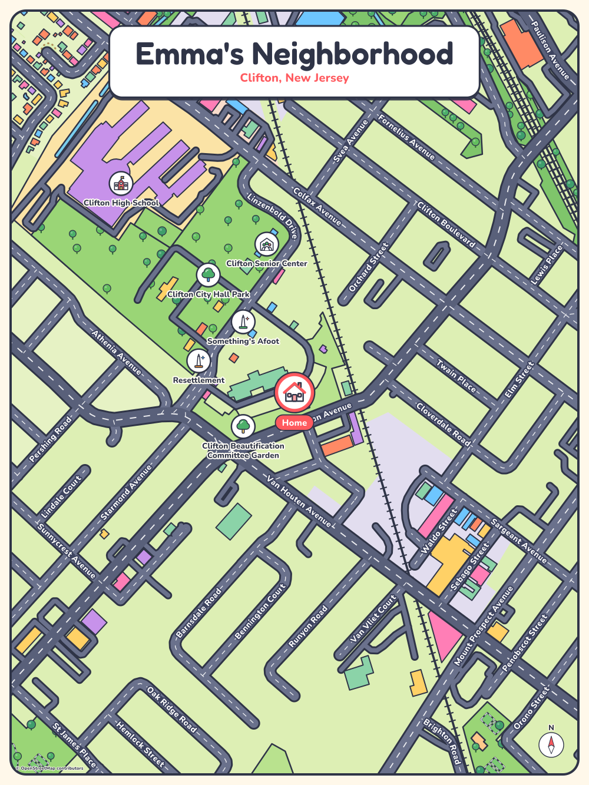

# Maploom *(working name)*

Enter an address → watch your neighborhood become illustrated artwork.

Maploom turns real OpenStreetMap data for any place into a personalised, editable,
print-ready illustrated map — for wall art, gifts and (soon) play mats.



## Quick start

```bash
npm install
npm run dev          # http://localhost:3000
```

No database, keys or accounts are needed in development: an embedded Postgres (PGlite),
a generated dev secret and public OpenStreetMap services are used by default.

Behind an HTTPS proxy (sandboxes, corporate networks) start with `NODE_USE_ENV_PROXY=1`.
Fully offline: `MAPLOOM_FIXTURE_TILES=tests/fixtures/tiles npm run dev` and pick the
"Clifton" sample.

## Commands

| Command | What it does |
|---|---|
| `npm run dev` | Web app + API + in-process job worker |
| `npm run build` / `npm start` | Production build / server |
| `npm run worker` | Standalone job worker (needs `DATABASE_URL`) |
| `npm test` | Unit + integration tests (Vitest, offline) |
| `npm run e2e` | End-to-end journey on desktop + mobile (Playwright, offline) |
| `npm run lint` / `npm run typecheck` | ESLint / TypeScript |
| `npm run demo:render` | Render the sample neighbourhood in every style to `.data/demo` |
| `npm run fixtures:refresh` | Re-download the test tiles (network) |
| `npx tsx scripts/bench-export.ts 300` | Time a 4×6 ft, 300 DPI print export |

Configuration: see [`.env.example`](.env.example). The admin area (`/admin`) is enabled by
setting `ADMIN_TOKEN`.

## How it fits together

```
packages/core     types, Design schema, products & pricing config, errors
packages/geo      projection, vector tiles → Geography, geocoding, landmark scoring
packages/render   styles, fonts → outlines, icons, deterministic SVG renderer
packages/server   DB, jobs, caches, export pipeline, projects, commerce ports
apps/web          Next.js UI + API + admin
apps/worker       standalone job worker
```

Start with [docs/ARCHITECTURE.md](docs/ARCHITECTURE.md) and
[docs/PROJECT_STATUS.md](docs/PROJECT_STATUS.md).

## Data & licences

Map data © [OpenStreetMap contributors](https://www.openstreetmap.org/copyright) (ODbL);
tiles by OpenFreeMap / OpenMapTiles. The credit line on the artwork is required and cannot
be switched off. Fonts are SIL OFL. Icons and styles are original to this project.
